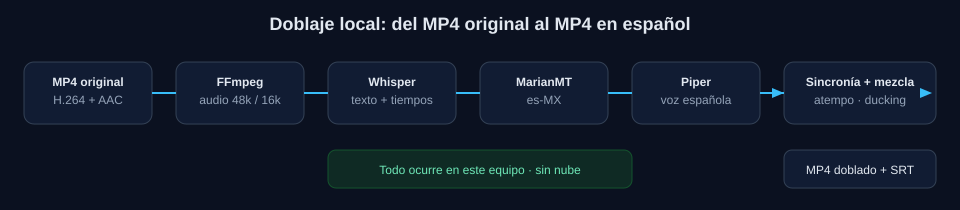

<div align="center">

# Spanish Dubbing Studio

### 🎬 Doblaje automático de video al español, 100 % local

**Local-first AI video dubbing to Spanish. No cloud, no accounts, no telemetry.**

[](https://github.com/IvanITT/VideoTranslator)
[](#plataforma-y-requisitos)
[](#dependencias)
[](#arquitectura-y-stack)
[](#arquitectura-y-stack)
[](LICENSE)
[](#privacidad-y-seguridad)

[](https://github.com/IvanITT/VideoTranslator)

[¿Qué es?](#qué-es) · [Características](#características) · [Instalación](#instalación) · [Uso](#uso) · [Modelos](#modelos-de-ia) · [Documentación](docs/)

</div>

---

> **Versión 1.0.0** · Windows 10/11 64-bit · CPU-first · Probado en un Intel i3-1115G4, 8 GB de RAM y sin GPU.
>
> Sube un MP4, transcribe su diálogo, tradúcelo al español, genera una voz, ajusta la duración al video original, mézclalo con el fondo y exporta un MP4 doblado con subtítulos. **Después de la descarga inicial de modelos, ningún video, audio o texto sale de tu PC.**

<details>
<summary><strong>Contenido</strong></summary>

- [¿Qué es?](#qué-es)
- [Características](#características)
- [Cómo funciona](#cómo-funciona)
- [Plataforma y requisitos](#plataforma-y-requisitos)
- [Instalación](#instalación)
- [Modelos de IA](#modelos-de-ia)
- [Uso](#uso)
- [Configuración](#configuración)
- [Dependencias](#dependencias)
- [Arquitectura y stack](#arquitectura-y-stack)
- [Privacidad y seguridad](#privacidad-y-seguridad)
- [Rendimiento y pruebas](#rendimiento-y-pruebas)
- [Estructura del proyecto](#estructura-del-proyecto)
- [Documentación](#documentación)
- [Solución de problemas](#solución-de-problemas)
- [Preguntas frecuentes](#preguntas-frecuentes)
- [Limitaciones y alcance](#limitaciones-y-alcance)
- [Contribuir](#contribuir)
- [Licencia y créditos](#licencia-y-créditos)

</details>

---

## ¿Qué es?

**Spanish Dubbing Studio** es una aplicación web local para doblar videos al español con inteligencia artificial. No es un servicio en la nube: el backend, la base de datos, los modelos y los archivos viven en tu equipo. La interfaz se sirve en `http://127.0.0.1:8765` y está pensada para un solo usuario.

El flujo completo es:

1. Subes un video MP4 con diálogo.
2. Whisper transcribe el audio.
3. MarianMT —o NLLB opcionalmente— traduce al español.
4. Piper genera la voz en español.
5. El audio se sincroniza con los tiempos originales.
6. Se mezcla con el fondo y se exporta el video doblado.
7. Puedes editar cada línea, regenerar su voz y volver a renderizar.



> La documentación técnica de `docs/` está en inglés. Este README resume el proyecto completo en español.

---

## Características

| Área | Qué incluye |
|---|---|
| **Doblaje completo** | Pipeline de 9 etapas: análisis, extracción, ASR, traducción, separación, TTS, sincronización, mezcla y render. |
| **Transcripción local** | faster-whisper con Whisper Tiny, Base o Small; VAD, CPU INT8 y soporte para 99 idiomas. |
| **Traducción local** | MarianMT para EN/FR/DE/PT/IT → ES; NLLB-200 opcional para 200 idiomas. |
| **Voces en español** | Piper con voz Ald (es-MX) por defecto, Claude (es-MX) y DaveFX (es-ES); fallback a SAPI de Windows. |
| **Sincronización** | Cada línea recibe su ventana temporal; acelera con `atempo` hasta 1.18× y avisa si no cabe. |
| **Mezcla de audio** | Cuatro modos, separación opcional con Demucs o fallback de FFmpeg, ducking y normalización a −16 LUFS. |
| **Editor por segmento** | Edita texto y tiempos, escucha cada línea, regenera una sola voz y vuelve a renderizar solo lo necesario. |
| **Recuperación** | Cada etapa guarda artefactos; puedes cancelar, cerrar la app y reanudar sin repetir trabajo completado. |
| **Gestor de modelos** | Descargas explícitas, estado de instalación, licencias visibles, eliminación y liberación de RAM. |
| **Privacidad** | Escucha por defecto en `127.0.0.1`, sin cuentas, sin telemetría y sin inferencia remota. |
| **Exportación** | MP4 con el video original copiado sin recodificar, más SRT, VTT y TXT. |
| **Interfaz** | React + TypeScript + Tailwind, en español, con Dashboard, Studio, Modelos y Ajustes. |

### Lo que no hace esta versión

- No clona voces ni convierte la voz de una persona en otra.
- No hace diarización: todos los hablantes usan la misma voz seleccionada.
- No regenera labios ni hace lip-sync.
- No descarga modelos automáticamente.
- No funciona como servicio remoto ni multiusuario.

---

## Cómo funciona


| # | Etapa | Qué hace | Artefacto principal |
|---|---|---|---|
| 1 | **Análisis** | Valida el contenedor, pista de audio, duración, resolución y genera miniatura. | `analysis.json` |
| 2 | **Extracción** | Extrae audio 48 kHz estéreo para la mezcla y 16 kHz mono para ASR. | `audio/original.wav`, `audio/asr.wav` |
| 3 | **Reconocimiento de voz** | Transcribe con faster-whisper, aplica VAD y normaliza/divide segmentos. | `transcript.json` + tabla `segments` |
| 4 | **Traducción** | Traduce cada segmento al español con MarianMT o NLLB. | `translation.json` + `text_es` |
| 5 | **Separación** | Opcional: separa voz y fondo con Demucs o estimación de cancelación central de FFmpeg. | `stems/background.wav` |
| 6 | **Generación de voz** | Sintetiza cada línea con Piper y la remuestrea a 48 kHz mono. | `tts/<idx>_<hash>.wav` |
| 7 | **Sincronización** | Planifica la línea de tiempo, aplica `atempo` y ensambla el doblaje. | `dub.wav`, `sync.json` |
| 8 | **Mezcla** | Aplica ducking, loudness y limiter; combina voz y fondo. | `mix.wav` |
| 9 | **Render** | Copia el stream de video original, codifica AAC y exporta video + subtítulos. | `output.mp4`, `subtitles/*` |

El progreso se calcula como una suma ponderada de las nueve etapas. La app mantiene el progreso por debajo del 100 % hasta que el trabajo termina correctamente.

### Sincronización y tiempos

Cada línea traducida recibe la ventana entre su inicio y el inicio de la siguiente línea, con un espacio mínimo configurable (`gap_ms`, 80 ms por defecto). Si la voz sintetizada dura más que la ventana, se acelera con FFmpeg `atempo` hasta `max_speedup` (1.18× por defecto). Si aun así no cabe, la línea se marca con una advertencia en la línea de tiempo y en el trabajo. La última línea puede comprimirse para conservar la duración del video. **Nada se corta en silencio sin avisar.**

---

## Plataforma y requisitos

| Componente | Mínimo | Recomendado | Notas |
|---|---|---|---|
| **Sistema operativo** | Windows 10 22H2 / 11, 64-bit | Windows 11 64-bit | Linux y macOS **no están probados oficialmente**. |
| **CPU** | 2 núcleos con AVX2 | 4+ hilos | El proyecto está optimizado para CPU. |
| **RAM** | 8 GB | 16 GB | Whisper Small y NLLB necesitan más memoria. |
| **Disco** | ~6 GB libres | 10+ GB | Entorno Python, FFmpeg, modelos y espacio de trabajo. |
| **Python** | 3.10–3.12 | **3.11 64-bit** | Python 3.13 no es compatible con los wheels fijados. |
| **Node.js** | 20 LTS o superior | 20/22 LTS | Solo se necesita para compilar la interfaz. |
| **FFmpeg** | Incluido por `setup.ps1` | FFmpeg 9.x essentials | Se puede usar uno propio con `VTS_FFMPEG` / `VTS_FFPROBE`. |
| **GPU** | Opcional | NVIDIA CUDA | Se detecta, pero la ruta probada es CPU. |
| **Internet** | Solo para instalar y descargar modelos | — | Después funciona completamente offline. |

> **Plataforma oficial: Windows 10/11 64-bit.** El backend es Python y podría adaptarse a otros sistemas, pero el launcher, los scripts y la instalación están pensados para Windows. No se ofrece soporte oficial para Linux/macOS en esta versión.

---

## Instalación

### 1. Requisitos previos

Instala Python 3.11 y Node.js 20 LTS. Si no los tienes:

```powershell
winget install Python.Python.3.11
winget install OpenJS.NodeJS.LTS
```

Cierra y vuelve a abrir PowerShell para que `py`, `python` y `npm` estén en el `PATH`.

También necesitas Git (opcional si descargas el ZIP) y unos **6 GB libres** en disco.

### 2. Clonar el repositorio

```powershell
git clone https://github.com/IvanITT/VideoTranslator.git
cd VideoTranslator
```

Si no usas Git, descarga el ZIP desde GitHub y descomprímelo.

### 3. Instalación automática (recomendada)

Desde la carpeta del proyecto:

```powershell
powershell -ExecutionPolicy Bypass -File .\scripts\setup.ps1
```

También puedes hacer doble clic en `scripts\setup.bat`.

El script realiza todo el trabajo pesado:

1. Busca Python 3.10, 3.11 o 3.12 (en ese orden) y crea `.venv`.
2. Actualiza `pip`, `setuptools` y `wheel`.
3. Instala `torch==2.5.1+cpu` desde el índice oficial de PyTorch.
4. Instala las dependencias de `requirements.txt`.
5. Descarga **FFmpeg essentials** desde gyan.dev en `tools\ffmpeg`.
6. Descarga **Piper 1.2.0** para Windows en `tools\piper`.
7. Ejecuta `npm install` y `npm run build` en `frontend\`.
8. Descarga el conjunto mínimo de modelos (~500 MB): Whisper Tiny, Marian EN→ES y la voz Piper `es_MX-ald-medium`.
9. Ejecuta `backend\verify_install.py` y muestra un informe.

**Opciones de instalación:**

| Flag | Efecto |
|---|---|
| `-SkipModels` | No descarga modelos ahora; se pueden bajar luego desde **Modelos**. |
| `-SkipBinaries` | Usa FFmpeg/Piper ya instalados; no descarga binarios. |
| `-SkipFrontend` | No ejecuta npm; útil para desarrollo solo-backend. |
| `-Force` | Elimina y recrea `.venv` (no toca modelos ni datos). |

Ejemplos:

```powershell
# Instalar solo la app y bajar modelos desde la interfaz
.\scripts\setup.ps1 -SkipModels

# Recrear el entorno Python desde cero
.\scripts\setup.ps1 -Force -SkipModels
```

Si PowerShell bloquea scripts, usa la forma `powershell -ExecutionPolicy Bypass -File ...` o el `.bat`. **No es necesario cambiar la política de ejecución de forma permanente.**

### 4. Iniciar la aplicación

La forma más sencilla es hacer doble clic en **`Spanish Dubbing Studio.exe`** en la raíz del proyecto, o en el acceso directo creado en el Escritorio y en el menú Inicio.

El lanzador:

- inicia el servidor local en segundo plano;
- espera a que `/api/health` responda;
- abre `http://127.0.0.1:8765`;
- deja un icono en el área de notificación.

Desde el icono puedes hacer **doble clic** para abrir la app, o **clic derecho** para iniciar/detener el servidor, abrir la carpeta de videos exportados, ver `storage\logs\server.log` o salir.

También puedes iniciar desde consola:

```powershell
powershell -ExecutionPolicy Bypass -File .\scripts\start.ps1
```

Opciones útiles:

```powershell
.\scripts\start.ps1 -Port 8766      # otro puerto si 8765 está ocupado
.\scripts\start.ps1 -NoBrowser      # no abrir el navegador
.\scripts\start.ps1 -Reload         # auto-reload para desarrollo
```

El `.exe` acepta además:

```powershell
& ".\Spanish Dubbing Studio.exe" --stop     # detener el servidor
& ".\Spanish Dubbing Studio.exe" --status   # 0 si el servidor está activo
& ".\Spanish Dubbing Studio.exe" --no-browser
```

> **SmartScreen:** la primera vez Windows puede advertir que el ejecutable no está firmado. Elige **Más información → Ejecutar de todas formas**. El archivo es el lanzador local incluido en el repositorio.

### 5. Verificar la instalación

```powershell
.\.venv\Scripts\python.exe backend\verify_install.py
```

La salida esperada comprueba FFmpeg, FFprobe, Piper, la interfaz compilada y los modelos instalados:

```text
[OK  ] FFmpeg: ffmpeg version 9.x ...
[OK  ] FFprobe: ffprobe version 9.x ...
[OK  ] Piper: 1.2.0
[OK  ] Frontend build: ...\frontend\dist
[OK  ] Speech recognition: whisper-tiny
```

### 6. Instalación manual (avanzada)

Si prefieres controlar cada paso, o ya tienes FFmpeg/Piper:

```powershell
py -3.11 -m venv .venv
.\.venv\Scripts\python.exe -m pip install --upgrade pip setuptools wheel
.\.venv\Scripts\python.exe -m pip install --index-url https://download.pytorch.org/whl/cpu "torch==2.5.1"
.\.venv\Scripts\python.exe -m pip install -r requirements.txt

cd frontend
npm install
npm run build
cd ..

.\.venv\Scripts\python.exe backend\download_models.py --minimal
.\.venv\Scripts\python.exe backend\verify_install.py
```

Para usar binarios propios, define las variables de entorno:

```powershell
$env:VTS_FFMPEG  = "C:\ruta\a\ffmpeg.exe"
$env:VTS_FFPROBE = "C:\ruta\a\ffprobe.exe"
$env:VTS_PIPER   = "C:\ruta\a\piper.exe"
```

O colócalos en `tools\ffmpeg\bin\` y `tools\piper\`. Si Piper no está disponible, la app usa la voz SAPI de Windows como respaldo.

### 7. Desarrollo

Terminal 1 — API con auto-reload:

```powershell
cd backend
..\.venv\Scripts\python.exe -m uvicorn app.main:app --host 127.0.0.1 --port 8765 --reload
```

Terminal 2 — interfaz Vite:

```powershell
cd frontend
npm run dev
```

Abre `http://localhost:5173` para desarrollo. Vite redirige `/api` al puerto 8765. Para la versión de producción, compila con `npm run build` y abre `http://127.0.0.1:8765`.

---

## Modelos de IA

El repositorio **no incluye pesos de modelos**. Se descargan solo cuando tú lo pides, desde la página **Modelos** o con `backend/download_models.py`. Los modelos viven en `models\` y están excluidos de Git.

### Conjunto mínimo recomendado

| Modelo | ID | Etapa | Tamaño | Licencia |
|---|---|---|---:|---|
| Whisper Tiny (faster-whisper, INT8) | `whisper-tiny` | ASR | ~75 MB | MIT |
| MarianMT EN→ES | `marian-en-es` | Traducción | ~310 MB | Apache-2.0 |
| Piper Ald (es-MX, medium) | `piper-es-mx-ald-medium` | TTS | ~63 MB | MIT (voz: Unlicense) |

**Total: ~500 MB.**

### Modelos opcionales

| Modelo | ID | Etapa | Tamaño | Licencia |
|---|---|---|---:|---|
| Whisper Base | `whisper-base` | ASR | ~145 MB | MIT |
| Whisper Small | `whisper-small` | ASR | ~484 MB | MIT |
| MarianMT FR→ES | `marian-fr-es` | Traducción | ~310 MB | Apache-2.0 |
| MarianMT DE→ES | `marian-de-es` | Traducción | ~310 MB | Apache-2.0 |
| MarianMT PT→ES | `marian-pt-es` | Traducción | ~300 MB | Apache-2.0 |
| MarianMT IT→ES | `marian-it-es` | Traducción | ~300 MB | Apache-2.0 |
| NLLB-200 Distilled 600M | `nllb-600m` | Traducción | ~2.5 GB | **CC-BY-NC-4.0 (no comercial)** |
| Piper Claude (es-MX, high) | `piper-es-mx-claude-high` | TTS | ~110 MB | MIT (revisar `MODEL_CARD`) |
| Piper DaveFX (es-ES, medium) | `piper-es-es-davefx-medium` | TTS | ~63 MB | MIT (revisar `MODEL_CARD`) |

> **NLLB-200 es solo para uso no comercial.** Revisa [docs/MODELS.md](docs/MODELS.md) y [THIRD_PARTY_NOTICES.md](THIRD_PARTY_NOTICES.md) antes de usarlo en un producto comercial.

### Descargar modelos

```powershell
# Ver IDs, tamaños, licencias y estado
.\.venv\Scripts\python.exe backend\download_models.py --list

# Conjunto mínimo (~500 MB)
.\.venv\Scripts\python.exe backend\download_models.py --minimal

# Un modelo concreto
.\.venv\Scripts\python.exe backend\download_models.py whisper-base

# Todo (~5.6 GB; lee las licencias primero)
.\.venv\Scripts\python.exe backend\download_models.py --all
```

Las descargas son reanudables: si interrumpes con `Ctrl+C`, la caché de Hugging Face se conserva y la siguiente ejecución continúa. No borres `models\<id>\.cache` si quieres reanudar.

Desde la interfaz puedes descargar, eliminar y liberar modelos de la RAM. Un modelo a medio descargar se marca como no instalado.

---

## Uso

1. **Dashboard → Nuevo doblaje**: arrastra un MP4 con diálogo audible.
2. Elige idioma de origen (o detección automática), variante de español, voz, modo de audio y perfil de calidad.
3. Inicia el trabajo y sigue las nueve etapas. La primera ejecución carga modelos; las siguientes reutilizan la caché hasta liberar RAM entre etapas.
4. Al terminar, compara el video original y el doblado en **Studio**.
5. Opcional: edita una línea en español, escucha su audio, regenera solo esa línea y pulsa **Volver a renderizar**. Solo se repiten las etapas afectadas.
6. Descarga el MP4, SRT, VTT o TXT.
7. Si un trabajo falla o cierras la app, abre el trabajo y pulsa **Reanudar**.

### Formatos y límites

- Entrada: **MP4/M4V** con contenedor MP4/MOV y pista de audio. Se recomienda **H.264 + AAC**.
- Límite de subida por defecto: **2048 MB**.
- Duración máxima por defecto: **3600 s (60 min)**.
- Salida: **MP4** con el stream de video original copiado y audio AAC (192 kbps por defecto).
- Subtítulos: **SRT**, **VTT** y **TXT**.

### Modos de audio

| Modo | Resultado |
|---|---|
| `dub_only` | Solo la voz en español; sin música ni efectos. Máxima inteligibilidad. |
| `replace_dialogue` | Voz en español + audio original atenuado al 35 %. |
| `dub_plus_background` | Voz en español + fondo separado si está disponible; si no, audio original al 90 %. **Modo por defecto.** |
| `dual` | Pista doblada + pista original como segunda pista AAC; el reproductor puede cambiar. |

La separación de voz/fondo es **opcional**. Si instalas Demucs, se usa para extraer el fondo; si no, se aplica el fallback de atenuación o cancelación central de FFmpeg. El ducking baja el fondo automáticamente cuando habla la voz española, y la mezcla se normaliza a **−16 LUFS** con limitador.

### Idiomas

- **ASR:** Whisper reconoce 99 idiomas.
- **Traducción con MarianMT:** inglés, francés, alemán, portugués e italiano → español.
- **Traducción con NLLB-200:** hasta 200 idiomas → español (modelo opcional y no comercial).
- **Variantes de español:** México (`es-MX`), España (`es-ES`) y neutro latinoamericano (`es-001`).

Si eliges un idioma de origen sin modelo de traducción instalado, la app lo indica antes de empezar y te pide descargar el modelo correspondiente.

### Dónde quedan los archivos

| Ruta | Contenido |
|---|---|
| `storage\projects\<id>\` | Video original, miniatura, artefactos por etapa y `output.mp4`. |
| `storage\exports\` | Copia de los videos finales para descargar. |
| `storage\uploads\` | Subidas temporales. |
| `storage\temporary\` | Archivos temporales de trabajo. |
| `storage\logs\server.log` | Log del servidor. |
| `storage\app.db` | Base de datos SQLite (proyectos, trabajos, segmentos, ajustes). |
| `models\` | Pesos de los modelos descargados. |

---

## Configuración

Los ajustes se guardan en SQLite y se pueden cambiar desde **Ajustes** o con `GET/PUT /api/settings`. Estos son los valores por defecto:

| Ajuste | Valor por defecto | Descripción |
|---|---|---|
| `preset` | `balanced` | Perfil de calidad: `low`, `balanced`, `high`. |
| `mode` | `dub_plus_background` | Modo de audio. |
| `voice` | `es_MX-ald-medium` | Voz Piper seleccionada. |
| `target_variant` | `es-MX` | Variante de español. |
| `source_language` | `auto` | Idioma de origen o detección automática. |
| `max_speedup` | `1.18` | Aceleración máxima permitida (1.0–1.6). |
| `gap_ms` | `80` | Separación mínima entre líneas (0–1000 ms). |
| `loudness_lufs` | `-16.0` | Objetivo de loudness (−30 a −6 LUFS). |
| `ducking` | `true` | Baja el fondo cuando habla la voz doblada. |
| `speech_rate` | `1.0` | Velocidad base de la voz (0.6–1.8). |
| `volume` | `1.0` | Volumen de la voz (0.0–2.0). |
| `device` | `auto` | `auto`, `cpu` o `cuda`. |
| `compute_type` | `int8` | Tipo de cómputo para ASR. |
| `quantize_translation` | `false` | Cuantización dinámica INT8 para traducción. |
| `max_upload_mb` | `2048` | Tamaño máximo de subida. |
| `max_duration_s` | `3600` | Duración máxima del video. |
| `cleanup_days` | `7` | Días antes de limpiar temporales. |
| `parallel_jobs` | `1` | Fijo en 1: la cola es de un solo worker. |

### Variables de entorno

| Variable | Por defecto | Uso |
|---|---|---|
| `VTS_ROOT` | Raíz del proyecto | Directorio raíz de la aplicación. |
| `VTS_DATA_DIR` | `storage\` | Base de datos, subidas, proyectos y exports. |
| `VTS_MODELS_DIR` | `models\` | Carpeta de pesos de modelos. |
| `VTS_FFMPEG` | Autodetectado | Ruta explícita a `ffmpeg.exe`. |
| `VTS_FFPROBE` | Autodetectado | Ruta explícita a `ffprobe.exe`. |
| `VTS_PIPER` | Autodetectado | Ruta explícita a `piper.exe`. |
| `VTS_HOST` | `127.0.0.1` | Interfaz de escucha. **No la expongas a la red.** |
| `VTS_PORT` | `8765` | Puerto HTTP. |
| `VTS_OFFLINE` | `false` | Fuerza modo offline si está en `1`, `true`, `yes` u `on`. |
| `VTS_MAX_UPLOAD_MB` | `2048` | Límite de subida. |
| `VTS_MAX_DURATION_S` | `3600` | Duración máxima. |

---

## Dependencias

### Backend (Python)

Fijadas en [`requirements.txt`](requirements.txt):

| Paquete | Versión | Uso |
|---|---|---|
| `fastapi` | 0.115.14 | API HTTP. |
| `uvicorn[standard]` | 0.34.3 | Servidor ASGI. |
| `python-multipart` | 0.0.32 | Subida de archivos. |
| `pydantic` / `pydantic-settings` | 2.14.1 / 2.16.2 | Validación y configuración. |
| `psutil` | 7.2.2 | Memoria y hardware. |
| `numpy` | 1.26.4 | Procesamiento numérico. |
| `soundfile` | 0.14.0 | Lectura/escritura de audio. |
| `huggingface-hub` | 0.36.2 | Descarga de modelos. |
| `faster-whisper` | 1.2.1 | ASR con CTranslate2. |
| `transformers` | 4.49.0 | MarianMT y NLLB. |
| `sentencepiece` | 0.2.2 | Tokenización de traducción. |
| `sacremoses` | 0.2.0 | Normalización de texto. |
| `torch` | 2.5.1 | PyTorch; se instala aparte en versión CPU o CUDA. |
| `pytest` / `httpx` | 9.2.0 / 0.28.1 | Pruebas. |

### Frontend (Node.js)

Fijadas en [`frontend/package.json`](frontend/package.json):

| Paquete | Versión | Uso |
|---|---|---|
| `react` / `react-dom` | 18.3.1 | Interfaz. |
| `react-router-dom` | 6.28.0 | Rutas SPA. |
| `lucide-react` | 0.468.0 | Iconos. |
| `vite` | 6.0.3 | Build y dev server. |
| `typescript` | 5.6.3 | Tipado. |
| `tailwindcss` | 3.4.16 | Estilos. |
| `postcss` / `autoprefixer` | 8.4.49 / 10.4.20 | Pipeline CSS. |

### Binarios y herramientas

| Herramienta | Versión | Licencia | Notas |
|---|---|---|---|
| **FFmpeg / FFprobe** | 9.x essentials (probado 9.0.2) | **GPLv3** en el build de gyan.dev | Se descarga en `tools\ffmpeg`. |
| **Piper** | 1.2.0 (2023.11.14-2) | MIT (incluye espeak-ng GPLv3) | Se descarga en `tools\piper`. |
| **CTranslate2** | Incluido con faster-whisper | MIT | Runtime de Whisper. |
| **ONNX Runtime** | Incluido con Piper | MIT | Runtime de voces Piper. |
| **SQLite** | Stdlib de Python | Dominio público | Base de datos local. |

### Desarrollo y pruebas

- Python 3.10–3.12 (3.11 recomendado).
- Node.js 20 LTS o superior.
- `pytest` + `httpx`.
- FFmpeg/FFprobe y Piper para las pruebas de integración.

---

## Arquitectura y stack

| Capa | Tecnología |
|---|---|
| **Backend** | FastAPI 0.115 + Uvicorn + Pydantic 2. |
| **Base de datos** | SQLite en modo WAL, sin ORM, conexiones cortas. |
| **ASR** | faster-whisper + CTranslate2 (CPU INT8 o CUDA FP16). |
| **Traducción** | Transformers + PyTorch (MarianMT / NLLB). |
| **TTS** | Piper + ONNX Runtime; fallback a SAPI de Windows. |
| **Media** | FFmpeg/FFprobe como subprocesos. |
| **Frontend** | React 18 + TypeScript 5.6 + Vite 6 + Tailwind 3.4 + React Router 6 + Lucide. |
| **Launcher** | C# con el compilador incluido en Windows (.NET Framework). |
| **Pruebas** | pytest + httpx; E2E real con FFmpeg, Whisper, Marian y Piper. |

La app es **un solo proceso FastAPI** que sirve la SPA, atiende la API, posee SQLite y ejecuta **un worker de fondo**. No hay servicio externo en tiempo de ejecución. Cada trabajo guarda sus artefactos en disco, de modo que un reinicio puede reutilizar las etapas completadas.

```text
Navegador (localhost)
        │  fetch /api/*  (mismo origen, X-VTS-Client: web)
        ▼
FastAPI + middleware de seguridad
        │
        ├── Routers → SQLite (projects, jobs, stages, segments, events, settings)
        │
        └── Worker único → Pipeline de 9 etapas
                ├── FFmpeg / FFprobe
                ├── Whisper (CTranslate2)
                ├── MarianMT / NLLB (PyTorch)
                └── Piper / SAPI
```

### API HTTP

Todas las rutas viven bajo `/api`. Las lecturas no requieren cabecera; las escrituras requieren `X-VTS-Client: web`, un `Host` local y mismo origen. El esquema OpenAPI está en `/api/openapi.json`; Swagger UI está deshabilitado.

<details>
<summary><strong>Ver endpoints principales</strong></summary>

| Método | Ruta | Propósito |
|---|---|---|
| `GET` | `/api/health` | Comprobaciones de componentes y cola. |
| `GET` | `/api/system` | Hardware, modelos, almacenamiento y capacidades. |
| `GET` | `/api/options` | Idiomas, variantes, modos, presets, voces y separación. |
| `GET` / `POST` | `/api/projects` | Listar / subir proyecto (multipart `file`, `name` opcional). |
| `GET` / `DELETE` | `/api/projects/{id}` | Detalle con trabajos / eliminar (bloqueado si hay uno activo). |
| `GET` | `/api/projects/{id}/thumbnail` | Miniatura JPEG. |
| `GET` | `/api/projects/{id}/video` | Video original con soporte de rangos. |
| `POST` | `/api/projects/{id}/jobs` | Crear y encolar un trabajo (`JobSettings`). |
| `GET` | `/api/jobs` | Trabajos recientes (`limit`, `active_only`). |
| `GET` / `DELETE` | `/api/jobs/{id}` | Detalle + cola / eliminar si no está activo. |
| `POST` | `/api/jobs/{id}/cancel` | Cancelación cooperativa. |
| `POST` | `/api/jobs/{id}/resume` | Reencolar etapas no completadas. |
| `POST` | `/api/jobs/{id}/rerender` | Reencolar tras editar segmentos. |
| `GET` | `/api/jobs/{id}/events` | Log del trabajo. |
| `GET` | `/api/jobs/{id}/segments` | Transcripción y duración. |
| `PATCH` | `/api/jobs/{id}/segments/{idx}` | Editar texto español, inicio o fin. |
| `POST` | `/api/jobs/{id}/segments/{idx}/regenerate` | Regenerar TTS de una línea y re-renderizar. |
| `GET` | `/api/jobs/{id}/segments/{idx}/audio` | Vista previa WAV. |
| `GET` | `/api/jobs/{id}/media/{kind}` | Original, output, dub, mix o background. |
| `GET` | `/api/jobs/{id}/download` | MP4 final. |
| `GET` | `/api/jobs/{id}/subtitles/{srt,vtt,txt}` | Subtítulos y transcripción. |
| `GET` | `/api/models` | Manifiesto, estado de instalación y descargas. |
| `GET` / `DELETE` | `/api/models/{id}` | Un modelo / eliminar pesos. |
| `POST` | `/api/models/{id}/download` | Descarga explícita en segundo plano. |
| `POST` | `/api/models/unload` | Liberar ASR y traducción de la RAM. |
| `GET` / `PUT` | `/api/settings` | Ajustes globales. |
| `POST` | `/api/maintenance/cleanup?days=N` | Limpiar temporales antiguos. |

Los errores siempre tienen la forma:

```json
{
  "error": {
    "code": "model_missing",
    "message": "Faltan modelos para iniciar el doblaje.",
    "hint": "Abre Modelos y descarga los modelos esenciales."
  }
}
```

</details>

### Base de datos

Tablas principales: `projects`, `jobs`, `job_stages`, `segments`, `events`, `settings` y `model_downloads`. Los ajustes del trabajo se congelan al crearlo. `settings.resume` distingue una ejecución normal de una reanudación. No hay migraciones entre versiones mayores: si el esquema es incompatible, hay que eliminar `storage\app.db` (perdiendo proyectos y ajustes).

---

## Privacidad y seguridad

- El servidor escucha **por defecto solo en `127.0.0.1`** y rechaza cabeceras `Host` que no sean locales (protección contra DNS rebinding).
- Las peticiones de escritura requieren `X-VTS-Client: web` y mismo origen; se rechaza `Sec-Fetch-Site: cross-site`. Esto bloquea formularios cross-site y páginas locales maliciosas.
- Las rutas de medios se resuelven y se comprueban contra el directorio de datos; los nombres se sanean y se limitan tamaño y duración.
- Los subprocesos usan listas de argumentos (nunca `shell=True`), `-nostdin`, buffers acotados, timeouts y cancelación.
- Cabeceras de seguridad: CSP, `nosniff`, `X-Frame-Options: DENY`, `Referrer-Policy: no-referrer`. No se emiten cabeceras CORS.
- **Sin analíticas, sin telemetría, sin cuentas, sin base de datos remota y sin inferencia en la nube.**
- La única red se usa al descargar modelos o herramientas, ya sea durante la instalación o desde la página **Modelos**. Después puedes desconectarte y todo sigue funcionando.
- **No hay autenticación.** Es una herramienta de un solo usuario: no expongas el puerto 8765 a tu LAN ni a Internet.

---

## Rendimiento y pruebas

### Rendimiento de referencia

Probado en **Windows 11**, Intel **i3-1115G4** (2 núcleos / 4 hilos), **8 GB de RAM** y **sin GPU**:

- Un clip de **12.7 s** completa el flujo E2E en aproximadamente **20 s**, incluyendo la transcripción de verificación.
- La primera ejecución es más lenta porque carga modelos; las siguientes reutilizan la caché.
- Videos más largos escalan con la duración. El pipeline informa progreso y se puede cancelar.
- La cola es de **un solo trabajo a la vez** para no agotar la RAM en equipos de 8 GB.

### Pruebas

```powershell
cd backend

# Pruebas rápidas (sin E2E real)
..\.venv\Scripts\python.exe -m pytest -m "not slow"

# E2E real: FFmpeg + Whisper + Marian + Piper
..\.venv\Scripts\python.exe -m pytest -m slow

# Todo
..\.venv\Scripts\python.exe -m pytest
```

Resultados en la máquina de desarrollo para la versión 1.0.0:

```text
132 passed, 1 deselected in 17.35s     # pytest -m "not slow"
1 passed, 132 deselected in 20.44s     # pytest -m slow
```

La suite cubre validación de subida y API, seguridad/CSRF/contención de rutas, probing/extracción/miniaturas de FFmpeg, conversión de tiempos y subtítulos, adaptadores de ASR y traducción (mockeados), timing/alineación/atempo, cancelación, recuperación tras fallo y reutilización de artefactos, mezcla de audio, muxing MP4 y un E2E real que vuelve a transcribir la salida para confirmar que es español. Más detalle en [docs/ARCHITECTURE.md](docs/ARCHITECTURE.md#tests).

---

## Estructura del proyecto

```text
VideoTranslator/
├── backend/
│   ├── app/
│   │   ├── api/            Routers FastAPI (projects, jobs, models, settings, system)
│   │   ├── core/           Configuración, errores tipados, seguridad localhost
│   │   ├── database/       Esquema SQLite y repositorios
│   │   ├── schemas/        Modelos Pydantic de request/response
│   │   ├── services/       FFmpeg, ASR, traducción, TTS, separación, alineación, mezcla
│   │   ├── workers/        Cola de un worker y pipeline reanudable
│   │   └── main.py         Punto de entrada FastAPI
│   ├── tests/              Suite pytest (rápida + E2E lenta)
│   ├── download_models.py  Descarga explícita de modelos
│   └── verify_install.py   Verificación de la instalación
├── frontend/               React 18 + TypeScript + Vite + Tailwind
│   └── src/
│       ├── pages/          Dashboard, Studio, Models, Settings
│       ├── components/     Layout, StageTracker, SegmentEditor, UploadDropzone...
│       ├── api/            Cliente tipado y tipos
│       └── hooks/          Polling y estado
├── launcher/               Código C# + build.ps1 del lanzador
├── models/                 manifest.json + pesos descargados (ignorados por Git)
├── scripts/                setup.ps1 / start.ps1 y lanzadores .bat
├── tools/                  FFmpeg y Piper locales (instalados por setup)
├── storage/                Base de datos, subidas, proyectos, exports y logs
├── docs/                   INSTALL, ARCHITECTURE, MODELS, TROUBLESHOOTING
├── samples/                Clips de ejemplo locales (ignorados por Git)
├── Spanish Dubbing Studio.exe   Lanzador de un clic (~380 KB)
├── requirements.txt
├── THIRD_PARTY_NOTICES.md
├── LICENSE
└── README.md
```

`Spanish Dubbing Studio.exe` usa el `.venv` creado por `setup.ps1`; no incluye Python ni modelos. Es pequeño y no necesita runtime adicional.

Para reconstruir el ejecutable después de mover la carpeta o cambiar el icono:

```powershell
powershell -ExecutionPolicy Bypass -File .\launcher\build.ps1
```

Usa el compilador de C# incluido en Windows y regenera los accesos directos del Escritorio y del menú Inicio.

---

## Documentación

- [Guía de instalación](docs/INSTALL.md) — requisitos, instalación manual y uso offline.
- [Arquitectura](docs/ARCHITECTURE.md) — pipeline, timing, base de datos, API, seguridad y pruebas.
- [Modelos y licencias](docs/MODELS.md) — tamaños, licencias y uso comercial.
- [Solución de problemas](docs/TROUBLESHOOTING.md).
- [Avisos de terceros](THIRD_PARTY_NOTICES.md).

---

## Solución de problemas

Primero ejecuta la verificación:

```powershell
.\.venv\Scripts\python.exe backend\verify_install.py
```

| Problema | Causa probable | Solución |
|---|---|---|
| **Python no encontrado / error con 3.13** | Python incorrecto o no está en PATH. | Instala Python 3.11 y vuelve a ejecutar `setup.ps1`. |
| **PowerShell bloquea el script** | Política de ejecución. | Usa `powershell -ExecutionPolicy Bypass -File .\scripts\setup.ps1` o `setup.bat`. |
| **403 Forbidden** | Estás abriendo la UI desde otro origen o un script no envía la cabecera. | Usa `http://127.0.0.1:8765`; los scripts deben enviar `X-VTS-Client: web`. |
| **“Faltan modelos”** | No hay modelos ASR/traducción/TTS instalados. | Abre **Modelos** y descarga los esenciales. |
| **Sin memoria / el trabajo falla** | RAM insuficiente para el modelo elegido. | Usa Whisper Tiny, baja hilos, cierra apps y libera modelos desde **Modelos**. |
| **Puerto 8765 ocupado** | Otra instancia sigue activa. | `& ".\Spanish Dubbing Studio.exe" --stop` o usa `start.ps1 -Port 8766`. |
| **Audio desincronizado o acelerado** | La traducción no cabe en la ventana temporal. | Acorta el texto en Studio o baja `max_speedup`. La app avisa, no corta en silencio. |
| **Se oye el diálogo original** | El modo conserva el audio original. | Usa `dub_only` o instala Demucs para separar el fondo. |
| **FFmpeg no encontrado** | Binario ausente o ruta incorrecta. | Ejecuta `setup.ps1` o define `VTS_FFMPEG` / `VTS_FFPROBE`. |
| **La interfaz no carga** | `frontend\dist` no existe. | Ejecuta `npm install && npm run build` en `frontend\`. |
| **SmartScreen bloquea el .exe** | Ejecutable sin firma. | **Más información → Ejecutar de todas formas**. |
| **Error de esquema de base de datos** | Versión mayor incompatible. | Haz copia de `storage\` y elimina `storage\app.db`; se perderán proyectos/ajustes. |

Logs: `storage\logs\server.log`. Más casos en [docs/TROUBLESHOOTING.md](docs/TROUBLESHOOTING.md).

---

## Preguntas frecuentes

<details>
<summary><strong>¿Necesito internet para usarlo?</strong></summary>

Solo para la instalación y para descargar modelos o binarios. Una vez descargados, puedes desconectarte y el doblaje funciona completamente offline.
</details>

<details>
<summary><strong>¿Mis videos se suben a algún servidor?</strong></summary>

No. El backend escucha en `127.0.0.1`, no hay cuentas ni telemetría y la inferencia es local. Los archivos se quedan en `storage\`.
</details>

<details>
<summary><strong>¿Puedo doblar videos de YouTube?</strong></summary>

Solo si tienes derechos sobre el contenido. Descarga el video por los medios que permita la plataforma y súbelo como archivo local; la app no descarga de YouTube.
</details>

<details>
<summary><strong>¿Clona la voz del hablante original?</strong></summary>

No. Esta versión usa una sola voz en español para todas las líneas. No hay clonación, conversión de voz ni diarización.
</details>

<details>
<summary><strong>¿Cuánto tarda un video?</strong></summary>

Depende de la duración, la CPU y el modelo. En la máquina de referencia (i3-1115G4, 8 GB, CPU), un clip de 12.7 s tarda ~20 s en el E2E. Videos largos escalan con la duración; la primera ejecución incluye carga de modelos.
</details>

<details>
<summary><strong>¿Puedo usar la GPU?</strong></summary>

La app detecta CUDA, pero la instalación por defecto usa PyTorch CPU y la ruta probada es CPU. Si quieres CUDA, instala el wheel correspondiente de PyTorch y ajusta `device`/`compute_type`; no es la configuración oficialmente probada.
</details>

<details>
<summary><strong>¿Funciona en Linux o macOS?</strong></summary>

No está soportado oficialmente. El backend es Python y podría adaptarse, pero el launcher, los scripts de instalación y la integración con Piper/SAPI están pensados para Windows.
</details>

<details>
<summary><strong>¿Puedo usarlo comercialmente?</strong></summary>

El código es MIT, pero las licencias de modelos y binarios son independientes: FFmpeg (build GPLv3), Piper/espeak-ng, voces Piper y NLLB-200 (**CC-BY-NC-4.0, no comercial**). Revisa [THIRD_PARTY_NOTICES.md](THIRD_PARTY_NOTICES.md) y [docs/MODELS.md](docs/MODELS.md) antes de redistribuir o monetizar.
</details>

<details>
<summary><strong>¿Puedo cambiar la voz o el idioma?</strong></summary>

Sí. Descarga otra voz Piper desde **Modelos** y selecciónala en Ajustes o al crear el trabajo. Para otros idiomas de origen, instala el par Marian correspondiente o NLLB-200.
</details>

<details>
<summary><strong>¿Dónde están los archivos y cómo los respaldo?</strong></summary>

Todo está en `storage\` (base de datos, proyectos, exports y logs) y `models\` (pesos). Copia esas carpetas para respaldar. `storage\` y `models\` están excluidos de Git.
</details>

---

## Limitaciones y alcance

- **Una sola voz** para todos los hablantes; sin diarización ni clonación.
- **Sin lip-sync** ni regeneración visual del rostro.
- **Separación opcional**: Demucs no viene incluido. Sin él, el fallback puede atenuar o eliminar música centrada.
- **Calidad de traducción dependiente del modelo**: Marian está enfocado en EN→ES; para otros idiomas hace falta el par correspondiente o NLLB (no comercial).
- **Aceleración agresiva**: puede sonar poco natural. La app avisa, pero no reescribe el texto en silencio.
- **Un solo worker**: no hay trabajos en paralelo (`parallel_jobs` fijo en 1).
- **Sin autenticación**: debe permanecer en localhost.
- **Sin migraciones de base de datos** entre versiones mayores.
- **GPU detectada, no probada** como ruta principal.
- **Windows 10/11 64-bit** es la única plataforma oficial.
- **Entrada MP4/MOV con audio**; no acepta audio-only ni otros contenedores.
- **Sin descargas automáticas** de modelos.

Estas son decisiones deliberadas de la versión 1.0: doblaje fiable y sincronizado en una máquina CPU antes que identidad de voz o lip-sync.

---

## Contribuir

Las contribuciones son bienvenidas:

1. Haz un fork del repositorio.
2. Crea una rama descriptiva: `feat/nueva-voz`, `fix/sincronizacion`.
3. Mantén los cambios acotados y sigue el estilo del código existente.
4. Ejecuta las pruebas rápidas antes de abrir el PR:

   ```powershell
   cd backend
   ..\.venv\Scripts\python.exe -m pytest -m "not slow"
   ```

5. Abre un Pull Request explicando el cambio y cómo probarlo.

Para reportar un bug, incluye versión, sistema operativo, hardware, pasos para reproducir y las líneas relevantes de `storage\logs\server.log`. **No subas videos, bases de datos, modelos ni archivos de `storage\`** al repositorio.

---

## Licencia y créditos

El código de la aplicación se distribuye bajo la [**Licencia MIT**](LICENSE).

Los binarios y modelos descargados conservan sus propias licencias. En particular:

- **FFmpeg** (build de gyan.dev) es **GPLv3**; si redistribuyes los binarios, debes cumplir la GPL. Puedes usar un build LGPL y apuntar `VTS_FFMPEG`/`VTS_FFPROBE` a él.
- **Piper** es MIT, pero incluye **espeak-ng** (GPLv3) para fonemización.
- **NLLB-200** es **CC-BY-NC-4.0**: solo uso no comercial.
- Las voces Piper tienen términos por dataset; conserva el `MODEL_CARD` de cada voz.
- **Whisper** es MIT; **MarianMT / OPUS-MT** es Apache-2.0.

Lee [THIRD_PARTY_NOTICES.md](THIRD_PARTY_NOTICES.md) antes de redistribuir la app o usarla comercialmente.

### Créditos

| Proyecto | Uso |
|---|---|
| [OpenAI Whisper](https://github.com/openai/whisper) | Modelo de reconocimiento de voz. |
| [Systran faster-whisper](https://github.com/SYSTRAN/faster-whisper) | Implementación ASR con CTranslate2. |
| [Helsinki-NLP OPUS-MT](https://huggingface.co/Helsinki-NLP) | Modelos MarianMT de traducción. |
| [Meta NLLB-200](https://huggingface.co/facebook/nllb-200-distilled-600M) | Traducción multilingüe opcional. |
| [rhasspy/piper](https://github.com/rhasspy/piper) | Síntesis de voz local. |
| [FFmpeg](https://ffmpeg.org/) | Procesamiento de audio y video. |
| [FastAPI](https://fastapi.tiangolo.com/) | API y servidor local. |
| [React](https://react.dev/) · [Vite](https://vite.dev/) · [Tailwind CSS](https://tailwindcss.com/) · [Lucide](https://lucide.dev/) | Interfaz web. |
| [CTranslate2](https://github.com/OpenNMT/CTranslate2) · [ONNX Runtime](https://onnxruntime.ai/) | Runtimes de inferencia. |

### Aviso

Dobla únicamente contenido sobre el que tengas derechos o permiso. Tú eres responsable del uso que hagas del video, del audio y de los modelos descargados. Este proyecto no está afiliado ni respaldado por OpenAI, Meta, Hugging Face, FFmpeg, Piper, NVIDIA ni sus respectivos titulares.

---

<div align="center">

**Hecho para doblar video al español sin depender de la nube.**

[⬆ Volver arriba](#spanish-dubbing-studio)

</div>
